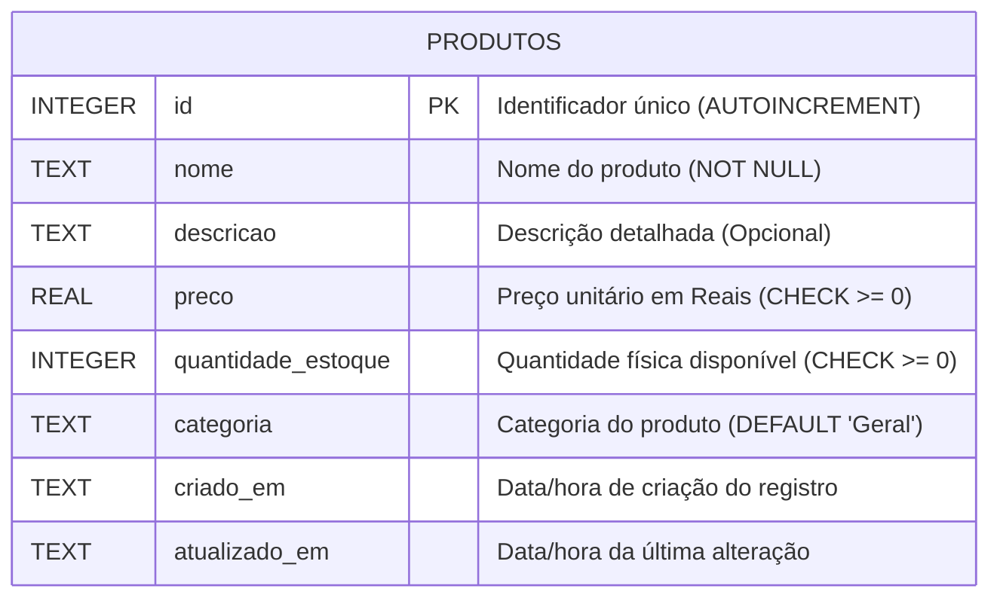

# RELATÓRIO TÉCNICO DE IMPLEMENTAÇÃO: CAMADA MODEL E BANCO DE DADOS
**Padrão Arquitetural MVC (Model-View-Controller)**  
**Disciplina:** Análise e Projeto de Software  
**Tema do Grupo:** Tema 2 — MVC  
**Responsável pelo Entregável:** André Luis  
**Aplicação (Prova de Conceito):** Sistema de Cadastro e Gestão de Produtos  
**Data da Entrega:** 23 de outubro de 2026  

---

## 1. INTRODUÇÃO E O PAPEL DA CAMADA MODEL NO PADRÃO MVC

O padrão arquitetural **MVC (Model-View-Controller)** foi concebido para desacoplar as responsabilidades de uma aplicação de software em três componentes fundamentais:
- **Model:** Gerencia o estado, os dados, as regras de negócio e a persistência.
- **View:** Apresenta visualmente os dados ao usuário final e captura suas ações.
- **Controller:** Atua como intermediário, recebendo as requisições da View, acionando o Model e selecionando a resposta adequada para a View.

Nesta divisão de trabalho do grupo, a responsabilidade do integrante **André Luis** consiste no desenvolvimento integral da **camada Model e da infraestrutura de banco de dados** da Prova de Conceito (PoC).

### 1.1 Responsabilidades da Camada Model
No design do projeto, o Model não atua apenas como uma "tabela de banco", mas sim como a autoridade central sobre o domínio da aplicação:
1. **Estrutura dos Dados:** Define os atributos de um Produto (`id`, `nome`, `descricao`, `preco`, `quantidade_estoque`, `categoria`, datas).
2. **Invariantes e Regras de Negócio:** Garante que nenhum produto seja cadastrado ou atualizado com dados inconsistentes (ex.: nome ausente, preço negativo ou estoque inválido).
3. **Cálculos de Domínio:** Fornece métodos semânticos como `temEstoque()`, `calcularValorTotalEstoque()` e formatação monetária localizada.
4. **Persistência Segura:** Gerencia a comunicação com o banco SQLite através de *Prepared Statements*, blindando a aplicação contra ataques de *SQL Injection*.

Desta forma, evita-se o antipadrão comum de *Fat Controller* (controladores sobrecarregados com lógica de dados) ou *Anemic Domain Model* (modelos que são meras estruturas de dados vazias de comportamento).

---

## 2. ESTRUTURAÇÃO DOS DADOS E MODELAGEM DO BANCO DE DADOS

### 2.1 Escolha Tecnológica: SQLite
Para a PoC prática, foi adotado o **SQLite** utilizando o driver de alta performance nativo do Node.js (`node:sqlite` - `DatabaseSync`).
- **Justificativa:** O SQLite é um banco de dados relacional baseado em arquivo local (`database.sqlite`), robusto, em conformidade com as propriedades ACID (Atomicidade, Consistência, Isolamento e Durabilidade) e dispensador de configurações complexas de servidores externos (como MySQL ou PostgreSQL), viabilizando execução imediata e reproduzível para todos os integrantes da equipe e para avaliação da disciplina.

### 2.2 Diagrama Entidade-Relacionamento (DER)



### 2.3 Dicionário de Dados

| Campo | Tipo no Banco | Nulo? | Restrições / Regras | Descrição |
| :--- | :--- | :--- | :--- | :--- |
| `id` | INTEGER | Não | PRIMARY KEY, AUTOINCREMENT | Identificador numérico sequencial único |
| `nome` | TEXT | Não | NOT NULL, mín. 2 e máx. 100 chars | Nome comercial do produto |
| `descricao` | TEXT | Sim | Opcional | Detalhamento técnico do produto |
| `preco` | REAL | Não | NOT NULL, CHECK (preco >= 0) | Valor unitário de venda em reais |
| `quantidade_estoque`| INTEGER | Não | DEFAULT 0, CHECK (>= 0) | Saldo físico em estoque |
| `categoria` | TEXT | Não | DEFAULT 'Geral', máx. 50 chars | Categoria de agrupamento |
| `criado_em` | TEXT (DATETIME)| Não | DEFAULT datetime('now', 'localtime') | Timestamp de cadastro inicial |
| `atualizado_em` | TEXT (DATETIME)| Não | DEFAULT datetime('now', 'localtime') | Timestamp da última atualização |

### 2.4 Script DDL de Criação (`src/database/schema.sql`)

```sql
-- Criação da tabela com restrições de integridade no banco
CREATE TABLE IF NOT EXISTS produtos (
    id INTEGER PRIMARY KEY AUTOINCREMENT,
    nome TEXT NOT NULL,
    descricao TEXT,
    preco REAL NOT NULL CHECK (preco >= 0),
    quantidade_estoque INTEGER NOT NULL DEFAULT 0 CHECK (quantidade_estoque >= 0),
    categoria TEXT NOT NULL DEFAULT 'Geral',
    criado_em TEXT NOT NULL DEFAULT (datetime('now', 'localtime')),
    atualizado_em TEXT NOT NULL DEFAULT (datetime('now', 'localtime'))
);

-- Índices secundários para aceleração de buscas e filtros
CREATE INDEX IF NOT EXISTS idx_produtos_nome ON produtos (nome);
CREATE INDEX IF NOT EXISTS idx_produtos_categoria ON produtos (categoria);
```

---

## 3. IMPLEMENTAÇÃO DA CAMADA MODEL: CÓDIGOS COMENTADOS

A camada Model foi arquitetada em dois módulos coesos:
1. `Product.js`: Entidade de Domínio responsável pelo estado e regras de negócio.
2. `ProductRepository.js`: Repositório de Acesso a Dados responsável pelo ciclo de vida e operações CRUD no SQLite.

### 3.1 Inicialização e Conexão com o Banco (`src/database/connection.js`)

O módulo de conexão gerencia a instância do banco via padrão *Singleton*, aplicando automaticamente os scripts DDL e ativando chaves estrangeiras e modo WAL (*Write-Ahead Logging*):

```javascript
const { DatabaseSync } = require('node:sqlite');
const path = require('node:path');
const fs = require('node:fs');

let dbInstance = null;

function getDatabase(customPath = null) {
  if (dbInstance && !customPath) return dbInstance;

  const dbPath = customPath || path.resolve(__dirname, '../../database.sqlite');
  const db = new DatabaseSync(dbPath);

  // Integridade e performance
  db.exec('PRAGMA foreign_keys = ON;');
  if (dbPath !== ':memory:') {
    db.exec('PRAGMA journal_mode = WAL;');
  }

  // Execução automática do schema inicial
  const schemaPath = path.resolve(__dirname, 'schema.sql');
  if (fs.existsSync(schemaPath)) {
    const schemaSql = fs.readFileSync(schemaPath, 'utf8');
    db.exec(schemaSql);
  }

  if (!customPath) dbInstance = db;
  return db;
}
```

---

### 3.2 Entidade de Domínio e Regras de Negócio (`src/models/Product.js`)

O trecho a seguir evidencia como o método `validate()` e `assertValid()` impedem estados inválidos no modelo antes de qualquer comunicação com o banco:

```javascript
class Product {
  constructor({ id = null, nome = '', descricao = '', preco = 0, quantidade_estoque = 0, categoria = 'Geral', criado_em = null, atualizado_em = null } = {}) {
    this.id = id !== null ? Number(id) : null;
    this.nome = typeof nome === 'string' ? nome.trim() : '';
    this.descricao = typeof descricao === 'string' ? descricao.trim() : '';
    this.preco = Number(preco);
    this.quantidade_estoque = Number(quantidade_estoque);
    this.categoria = typeof categoria === 'string' && categoria.trim() ? categoria.trim() : 'Geral';
    this.criado_em = criado_em;
    this.atualizado_em = atualizado_em;
  }

  // Validação de Regras de Negócio
  validate() {
    const errors = [];
    if (!this.nome || this.nome.length < 2) {
      errors.push('O nome do produto é obrigatório e deve ter no mínimo 2 caracteres.');
    }
    if (isNaN(this.preco) || this.preco <= 0) {
      errors.push('O preço deve ser um valor numérico positivo maior que zero (R$ 0,00).');
    }
    if (isNaN(this.quantidade_estoque) || !Number.isInteger(this.quantidade_estoque) || this.quantidade_estoque < 0) {
      errors.push('A quantidade em estoque deve ser um número inteiro maior ou igual a zero.');
    }
    return { isValid: errors.length === 0, errors };
  }

  // Métodos de Negócio
  temEstoque() {
    return this.quantidade_estoque > 0;
  }

  calcularValorTotalEstoque() {
    return Number((this.preco * this.quantidade_estoque).toFixed(2));
  }

  get precoFormatado() {
    return new Intl.NumberFormat('pt-BR', { style: 'currency', currency: 'BRL' }).format(this.preco);
  }
}
```

---

### 3.3 Repositório e Operações CRUD (`src/models/ProductRepository.js`)

O repositório fornece uma interface de alto nível para os Controllers realizarem as operações sem acoplamento a sintaxes de SQL:

#### Operação Create (com validação prévia):
```javascript
create(productData) {
  const product = new Product(productData);
  
  // O Model bloqueia dados inválidos
  product.assertValid();

  const stmt = this.db.prepare(`
    INSERT INTO produtos (nome, descricao, preco, quantidade_estoque, categoria)
    VALUES (?, ?, ?, ?, ?)
  `);

  const result = stmt.run(
    product.nome,
    product.descricao,
    product.preco,
    product.quantidade_estoque,
    product.categoria
  );

  return this.findById(Number(result.lastInsertRowid));
}
```

#### Operação Read (com filtros e ordenação segura):
```javascript
findAll({ search = null, categoria = null, sortBy = 'id', order = 'ASC' } = {}) {
  const allowedSortFields = ['id', 'nome', 'preco', 'quantidade_estoque', 'categoria', 'criado_em'];
  const safeSortBy = allowedSortFields.includes(sortBy) ? sortBy : 'id';
  const safeOrder = order.toUpperCase() === 'DESC' ? 'DESC' : 'ASC';

  const conditions = [];
  const params = [];

  if (search && search.trim()) {
    conditions.push('(nome LIKE ? OR descricao LIKE ?)');
    const term = `%${search.trim()}%`;
    params.push(term, term);
  }

  if (categoria && categoria.trim().toLowerCase() !== 'todas') {
    conditions.push('categoria = ?');
    params.push(categoria.trim());
  }

  let query = 'SELECT * FROM produtos';
  if (conditions.length > 0) {
    query += ` WHERE ${conditions.join(' AND ')}`;
  }
  query += ` ORDER BY ${safeSortBy} ${safeOrder}`;

  const stmt = this.db.prepare(query);
  const rows = stmt.all(...params);

  return rows.map(row => new Product(row));
}
```

#### Operação Update (com recálculo e timestamp):
```javascript
update(id, productData) {
  const existing = this.findById(id);
  if (!existing) throw new Error(`Produto com ID ${id} não foi encontrado.`);

  const updatedEntity = new Product({
    id: existing.id,
    nome: productData.nome !== undefined ? productData.nome : existing.nome,
    descricao: productData.descricao !== undefined ? productData.descricao : existing.descricao,
    preco: productData.preco !== undefined ? productData.preco : existing.preco,
    quantidade_estoque: productData.quantidade_estoque !== undefined ? productData.quantidade_estoque : existing.quantidade_estoque,
    categoria: productData.categoria !== undefined ? productData.categoria : existing.categoria,
    criado_em: existing.criado_em
  });

  updatedEntity.assertValid();

  const stmt = this.db.prepare(`
    UPDATE produtos
    SET nome = ?, descricao = ?, preco = ?, quantidade_estoque = ?, categoria = ?,
        atualizado_em = datetime('now', 'localtime')
    WHERE id = ?
  `);

  stmt.run(updatedEntity.nome, updatedEntity.descricao, updatedEntity.preco, updatedEntity.quantidade_estoque, updatedEntity.categoria, existing.id);
  return this.findById(existing.id);
}
```

#### Operação Delete:
```javascript
delete(id) {
  const existing = this.findById(id);
  if (!existing) throw new Error(`Produto com ID ${id} não foi encontrado.`);

  const stmt = this.db.prepare('DELETE FROM produtos WHERE id = ?');
  const result = stmt.run(Number(id));
  return result.changes > 0;
}
```

---

## 4. EVIDÊNCIAS DE EXECUÇÃO E TESTES (PRINTS E LOGS DE TERMINAL)

A suíte automatizada de testes foi executada pelo comando:
```bash
node scripts/test-model.js
```

Abaixo estão transcritos os registros exatos da execução, prontos para captura de tela ou inclusão no relatório final do grupo:

### 4.1 Evidência: Criação de Produtos e Validações de Regra de Negócio

```text
######################################################################
  TESTES DA CAMADA MODEL E BANCO DE DADOS (PoC MVC)
  Responsável: André Luis | Disciplina: Análise e Projeto de Software
######################################################################

======================================================================
📌 CENÁRIO 1: OPERAÇÃO CREATE (CRIAÇÃO E PERSISTÊNCIA NO BANCO)
======================================================================
Tentando cadastrar produtos com dados válidos...
[PASS] Produto 1 criado com sucesso! ID: 1 | Nome: "Notebook Dell XPS 13" | Preço: R$ 8.499,00
[PASS] Produto 2 criado com sucesso! ID: 2 | Nome: "Mouse Gamer sem fio Razer Viper" | Preço: R$ 599,90
[PASS] Produto 3 criado com sucesso! ID: 3 | Nome: "Webcam Logitech Brio 4K Ultra HD" | Preço: R$ 1.049,00

======================================================================
📌 CENÁRIO 2: VALIDAÇÕES DE REGRAS DE NEGÓCIO DO MODEL
======================================================================
O Model deve rejeitar tentativas de inserção com dados inválidos antes do banco:

Tentativa 2.1: Cadastrar produto com nome vazio...
[PASS] Rejeição esperada capturada: "Falha de validação no Model: O nome do produto é obrigatório e deve ter no mínimo 2 caracteres."

Tentativa 2.2: Cadastrar produto com preço zero ou negativo (-50.00)...
[PASS] Rejeição esperada capturada: "Falha de validação no Model: O preço deve ser um valor numérico positivo maior que zero (R$ 0,00)."

Tentativa 2.3: Cadastrar produto com estoque negativo (-3)...
[PASS] Rejeição esperada capturada: "Falha de validação no Model: A quantidade em estoque deve ser um número inteiro maior ou igual a zero."
```

### 4.2 Evidência: Consulta Geral, Filtros por Busca e Categoria

```text
======================================================================
📌 CENÁRIO 3: OPERAÇÃO READ (LISTAGEM GERAL, BUSCA E FILTROS)
======================================================================

--- [ 3.1 Listagem Completa de Produtos Cadastrados ] ---
Total de produtos retornados: 3
   [ID 1] Notebook Dell XPS 13                | Cat: Eletrônicos  | Preço: R$ 8.499,00    | Estoque:   7 un | Total Est.: R$ 59.493,00
   [ID 2] Mouse Gamer sem fio Razer Viper     | Cat: Periféricos  | Preço: R$ 599,90      | Estoque:  15 un | Total Est.: R$ 8.998,50
   [ID 3] Webcam Logitech Brio 4K Ultra HD    | Cat: Periféricos  | Preço: R$ 1.049,00    | Estoque:  10 un | Total Est.: R$ 10.490,00

--- [ 3.2 Filtro por Termo de Busca (Ex: "Dell") ] ---
Resultados encontrados com termo "Dell": 1
   -> [ID 1] Notebook Dell XPS 13 (R$ 8.499,00)

--- [ 3.3 Filtro por Categoria (Ex: "Periféricos") ] ---
Resultados na categoria "Periféricos": 2
   -> [ID 2] Mouse Gamer sem fio Razer Viper (Estoque: 15)
   -> [ID 3] Webcam Logitech Brio 4K Ultra HD (Estoque: 10)
```

### 4.3 Evidência: Consulta Detalhada por ID, Atualização (Update) e Exclusão (Delete)

```text
======================================================================
📌 CENÁRIO 4: OPERAÇÃO READ BY ID E MÉTODOS DO DOMÍNIO
======================================================================
Consulta por ID realizada com sucesso:
{
  "id": 1,
  "nome": "Notebook Dell XPS 13",
  "descricao": "Ultrabook Intel Core i7, 16GB RAM, SSD 1TB, tela OLED 13.4\" 3.5K touch.",
  "preco": 8499,
  "precoFormatado": "R$ 8.499,00",
  "quantidade_estoque": 7,
  "categoria": "Eletrônicos",
  "temEstoque": true,
  "valorTotalEstoque": 59493,
  "valorTotalEstoqueFormatado": "R$ 59.493,00",
  "criado_em": "2026-10-22 20:33:05",
  "atualizado_em": "2026-10-22 20:33:05"
}

Executando métodos de negócio da entidade:
- Tem estoque disponível? SIM
- Valor total do patrimônio em estoque: R$ 59.493,00

======================================================================
📌 CENÁRIO 5: OPERAÇÃO UPDATE (ATUALIZAÇÃO DE PREÇO E ESTOQUE)
======================================================================
Produto antes da atualização (ID 2):
   Nome: "Mouse Gamer sem fio Razer Viper" | Preço: R$ 599,90 | Estoque: 15 un.

Aplicando atualização: Preço de R$ 599,90 -> R$ 529,00 e Estoque de 15 -> 22 un.
[PASS] Produto atualizado com sucesso!
   ID: 2
   Novo Preço: R$ 529,00
   Novo Estoque: 22 un.
   Novo Valor Total do Estoque: R$ 11.638,00
   Data de Atualização: 2026-10-22 20:33:05

======================================================================
📌 CENÁRIO 6: OPERAÇÃO DELETE (EXCLUSÃO POR ID E CONFIRMAÇÃO)
======================================================================
Excluindo produto ID 3 ("Webcam Logitech Brio 4K Ultra HD")...
[PASS] Exclusão realizada com retorno: true
Consulta pelo ID 3 após exclusão: [PASS] Retornou null (confirmado que não existe no banco)
Total de produtos remanescentes no banco: 2

======================================================================
📌 RESULTADO FINAL DA SUÍTE DE TESTES
======================================================================
✅ TODAS AS OPERAÇÕES CRUD E REGRAS DE NEGÓCIO DO MODEL FORAM APROVADAS!
✅ Banco de dados SQLite persistido e íntegro.
✅ Camada Model pronta para consumo pelas Controllers e Views.
======================================================================
```

---

## 5. GUIA DE INTEGRAÇÃO PARA OS INTEGRANTES DE CONTROLLER E VIEW

Para o integrante **João André** (responsável por Controller e View), o consumo do Model é direto através do repositório:

### 5.1 Importação
```javascript
const productRepository = require('./models/ProductRepository');
```

### 5.2 Tabela de Métodos do Model Disponíveis

| Método | Parâmetros | Retorno | Descrição |
| :--- | :--- | :--- | :--- |
| `findAll(options)` | `{ search, categoria, sortBy, order }` | `Product[]` | Lista os produtos para exibição na View |
| `findById(id)` | `number \| string` | `Product \| null` | Detalha um produto para a tela de visualização ou edição |
| `create(data)` | `{ nome, preco, ... }` | `Product` | Cadastra novo produto e dispara `ValidationError` se inválido |
| `update(id, data)` | `id, { ... }` | `Product` | Atualiza produto existente com novas informações |
| `delete(id)` | `number \| string` | `boolean` | Remove o produto do banco |
| `count()` | Nenhum | `number` | Totalizador de produtos para dashboard/estatísticas |

Um exemplo completo de controlador integrador está disponível no arquivo `src/controllers/ProductController.example.js`.

---

## 6. CONCLUSÃO DO ENTREGÁVEL

A etapa da Prova de Conceito atribuída ao integrante **André Luis** foi plenamente concluída dentro do prazo (23/10/2026). Os artefatos entregues abrangem:
- O banco de dados SQLite relacional configurado e indexado;
- A modelagem da entidade de domínio com todas as validações de integridade;
- As operações CRUD desacopladas e protegidas com *Prepared Statements*;
- Os scripts automatizados de carga inicial (`seed.js`) e validação (`test-model.js`);
- Os trechos de código e logs prontos para enriquecer o relatório geral da equipe.
